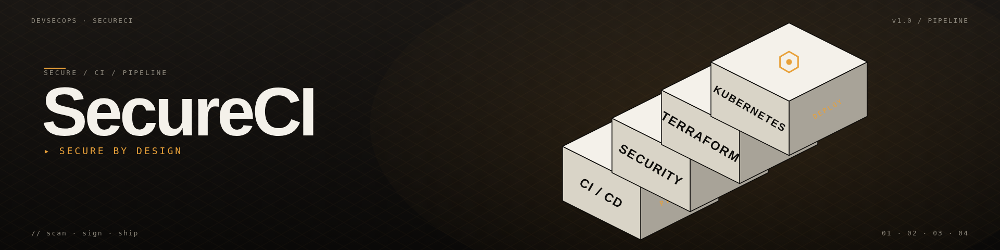

<div align="center">



# Pipeline ShiftLeft — Application Cloud Sécurisée

### *Pipeline DevSecOps de bout en bout : du code au conteneur, avec la sécurité intégrée à chaque étape.*


<br>


</div>

---

## Aperçu

Un **pipeline Dev(Sec)Ops complet** démontrant comment déployer une application Python containerisée en toute sécurité — du code source jusqu'au déploiement Kubernetes — avec des **portes de sécurité à chaque étape**.

Le pipeline échoue la construction si une vulnérabilité HIGH/CRITICAL est introduite : dans le code (SAST), dans les dépendances (SCA), dans les secrets commités, ou dans l'image Docker finale.

---

## Démonstration

**Étapes du pipeline exemple** (GitHub Actions):

```
OK Checkout                         1s
OK Setup Python 3.11                3s
OK Install security tools           12s
OK TruffleHog — secrets scan        8s
OK Bandit — SAST on app/            4s
OK Safety — dependency scan         6s
OK Docker build                     45s
OK Trivy — image scan               22s
OK Upload security artifacts        2s

Statut: succès — 0 HIGH, 0 CRITICAL
```

---

## Fonctionnalités

- Application Flask containerisée — image de base minimale, utilisateur non-root
- Pipeline CI/CD GitHub Actions — automatisé de `git push` à l'artefact prêt pour le déploiement
- SAST — Bandit scanne le code Python pour les vulnérabilités courantes (SQLi, credentials codés en dur, crypto faible)
- SCA — Safety vérifie les dépendances contre la base de données CVE
- Scan de secrets — TruffleHog scanne les commits et l'historique Git
- Scan de conteneur — Trivy identifie les CVE dans les couches d'image
- Infrastructure as Code — Terraform provisionne les ressources cloud
- Manifests Kubernetes — déploiement + service avec les meilleures pratiques de sécurité
- Upload des artefacts — chaque rapport de sécurité est sauvegardé comme artefact du pipeline

---

## Stack

| Couche | Outil |
|--------|-------|
| Application | Python 3.11 · Flask |
| Conteneur | Docker |
| CI/CD | GitHub Actions |
| SAST | Bandit |
| SCA | Safety |
| Secrets | TruffleHog |
| Scan d'image | Trivy |
| IaC | Terraform (AWS) |
| Orchestration | Kubernetes |

---

## Structure du projet

```
FirstWorkflow/
├── app/                     # Application Flask Python
│   ├── main.py
│   ├── requirements.txt
│   └── Dockerfile
├── k8s/                     # Manifests Kubernetes
│   ├── deployment.yaml
│   └── service.yaml
├── terraform/               # Infrastructure as Code
│   ├── main.tf
│   └── variables.tf
├── security/                # Configurations des scanners
│   ├── bandit.yaml
│   ├── safety-policy.json
│   ├── secrets.toml
│   └── trivy.yaml
└── .github/workflows/
    └── pipeline.yml         # Définition du pipeline CI/CD
```

---

## Démarrage rapide

### Lancer l'app en local

```bash
pip install -r app/requirements.txt
python app/main.py
# → http://127.0.0.1:5000
```

### Lancer les scans de sécurité en local

```bash
pip install bandit safety
bandit -r app/ -c security/bandit.yaml
safety check -r app/requirements.txt --policy-file security/safety-policy.json
```

### Builder et scanner l'image Docker

```bash
docker build -t secure-flask:latest app/
trivy image --config security/trivy.yaml secure-flask:latest
```

### Déclencher le pipeline

```bash
git push origin main
# → GitHub Actions exécute le pipeline complet automatiquement
```

---

## Pipeline CI/CD

Le pipeline (`.github/workflows/pipeline.yml`) exécute ces étapes dans l'ordre :

1. **Checkout** du code source
2. **Setup** de l'environnement Python
3. **Install** des dépendances et outils de sécurité
4. **TruffleHog** — scan des commits et de l'historique Git pour les secrets
5. **Bandit** — analyse statique du code Python
6. **Safety** — scan des vulnérabilités de dépendances
7. **Build** de l'image Docker
8. **Trivy** — scan de l'image pour les CVE
9. **Upload** de tous les rapports de sécurité comme artefacts du pipeline
10. **Fail** la construction si une vulnérabilité HIGH / CRITICAL est détectée

Chaque changement de code est automatiquement contrôlé par ces portes avant d'atteindre la production.

---

## Implémentation de sécurité

**Static Application Security Testing (SAST)** — `security/bandit.yaml` ajuste Bandit pour l'app Flask : SQLi, credentials codés en dur, crypto faible, désérialisation non sécurisée.

**Dependency Scanning (SCA)** — `security/safety-policy.json` définit les exceptions pour les CVE acceptées/low-risk ; tout le reste échoue la construction.

**Secrets Management** — TruffleHog scanne l'historique Git complet ; `security/secrets.toml` contient les règles de whitelist pour éviter les faux positifs sur les fixtures de test.

**Container Scanning** — Trivy est configuré via `security/trivy.yaml` pour échouer sur `HIGH` et `CRITICAL` ; les sévérités plus basses sont loggées mais non bloquantes.

**Kubernetes Hardening** — les pods tournent en non-root, filesystem root en lecture seule, resource limits définis, pas d'escalade de privilege.

---

## Infrastructure as Code

Terraform provisionne les ressources AWS (EC2, S3, IAM) avec un état versionné, reproductible et auditable — une base propre pour déployer le cluster Kubernetes.

---

## Roadmap

- [ ] Étape **DAST** avec OWASP ZAP contre un déploiement de staging
- [ ] Génération **SBOM** avec Syft + signature avec Cosign (hardening de la chaîne d'approvisionnement)
- [ ] Portes **Policy-as-Code** avec OPA / Conftest sur les manifests Kubernetes
- [ ] Scan **IaC** avec Checkov / tfsec sur Terraform
- [ ] **Dependabot** pour les PRs de dépendances automatisées
- [ ] Progressive delivery (canary / blue-green) via Argo Rollouts
- [ ] Observabilité: Prometheus + Grafana + Loki pour les métriques, logs et alertes

---

## Ce que j'ai appris

- **Shift-left security** — attraper les vulnérabilités en CI coûte 100× moins cher qu'en production
- **Défense en couches** — SAST, SCA, secrets et scan d'image attrapent chacun des classes de problèmes différentes
- **Design de pipeline** — stages qui échouent rapidement en premier (lint/secrets) avant les stages coûteux (container scans)
- **Supply chain** — comprendre que l'image que je déploie est la somme de **chaque couche**, pas juste mon code
- **Discipline IaC** — gestion d'état Terraform, séparation des variables, structure modulaire
- **Sécurité Kubernetes** — la différence entre un pod qui **tourne** et un pod qui tourne **sécurisé**

---

## Contexte

Projet d'apprentissage personnel — construit pour internaliser le cycle de vie DevSecOps complet de bout en bout.
Inspiré par des références industrielles : OWASP DevSecOps Maturity Model, Google SLSA, NIST SP 800-190.
